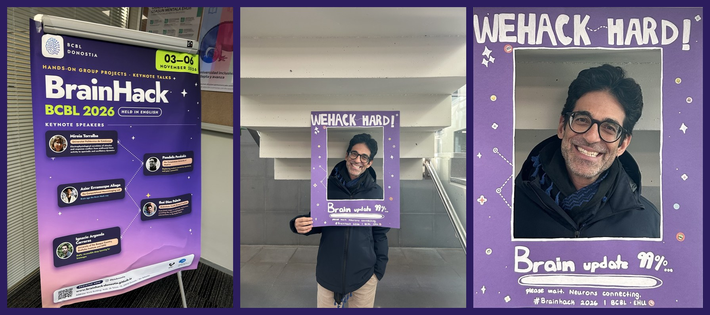

I gave a keynote at [BrainHack Donostia 2026](https://brainhack-donostia.github.io/){target="_blank"}, organised by the Basque Center on Cognition, Brain and Language (BCBL) in San Sebastián from 3 to 6 November. The talk, *Replacing academic journals with repositories and peer communities*, took place on 4 November. It argued that validation, evaluation and dissemination, the three processes journals bundle into one product, can each be done in repositories and by communities of peers, and it closed with the example of Psicológica, a diamond open access journal run by its academic community in collaboration with the institutional repository of the Spanish National Research Council (CSIC).

{fig-alt="Collage of three photographs: the BrainHack BCBL 2026 poster with the keynote speakers, and two photos of Pandelis Perakakis smiling inside the WeHack Hard photo frame."}

Here are my slides to view, open in a new tab or download as PDF:

  <iframe
    src="/talks/brainhack-donostia-2026/"
    style="width: 100%; aspect-ratio: 16/9; border: none; display: block;"
    title="Replacing academic journals with repositories and peer communities: slides"
    loading="lazy"
    allowfullscreen>
  </iframe>

[<i class="bi bi-easel"></i> Open the slides in a new tab](/talks/brainhack-donostia-2026/){.btn .btn-outline-primary .btn-sm target="_blank"}
[<i class="bi bi-file-earmark-pdf"></i> Slides (PDF)](/talks/brainhack-donostia-2026/brainhack-donostia-2026.pdf){.btn .btn-outline-primary .btn-sm target="_blank"}

## reprocheck: a reproducibility check on GitHub

On the morning of the keynote I pitched a hackathon project, [reprocheck](https://github.com/perakakis/reprocheck){target="_blank"}, an automated reproducibility check that a journal can run before peer review. The checker copies the authors' code and data, exactly as deposited, into a copy of the reprocheck template on GitHub and starts the workflow from the Actions tab. The workflow rebuilds the R environment as it was on the date of the deposit, with the R version and package versions of that date, runs each script unchanged in its own R session and produces an HTML report. For each script the report shows the files it wrote, compared with the files of the same name in the deposit, its figures, the tables it saved and its full console output. Two optional steps call [metacheck](https://github.com/scienceverse/metacheck){target="_blank"} to inspect the deposited files and to match the statistical tests reported in the manuscript with those the code reproduces. The checker then compares the reproduced values with the article and records a verdict in an issue. reprocheck follows the principles of [CODECHECK](https://codecheck.org.uk){target="_blank"}: the checker runs the code without fixing it and records what happened.

A wonderful, enthusiastic hackathon team formed around the project and extended reprocheck so that it runs several scripts in order, each passing its results to the next through the files it writes. We tested this version on a simulated deposit and on the deposit of a recently published article. The code is open under the MIT licence, and any journal or research group can copy the template and run its own checks.

[<i class="bi bi-github"></i> reprocheck on GitHub](https://github.com/perakakis/reprocheck){.btn .btn-outline-primary .btn-sm target="_blank"}

Many thanks to Manuela Ruzzoli, Iria Nieto Rebollo and the BrainHack Donostia organisers for the invitation, and to the team that worked on reprocheck.
