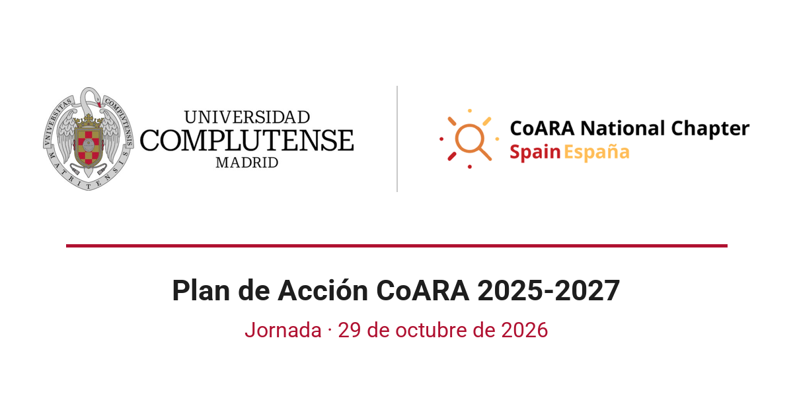

Hoy, 29 de octubre, la Universidad Complutense de Madrid celebra la jornada «La UCM ante la reforma europea de la evaluación de la investigación», en la que presenta su [Plan de Acción CoARA 2025-2027](plan-accion-coara-ucm.qmd). La inauguran Lucía de Juan Ferré, vicerrectora de Investigación y Transferencia, y Antonio Moreno, director de la Biblioteca UCM.

La primera intervención, «Por qué es necesario reformar la evaluación de la investigación: el contexto internacional y la respuesta de CoARA», la compartimos Antonio Calderón-Rehecho, de la Biblioteca UCM, y yo. Empiezo por el factor de impacto, que Eugene Garfield ideó para comparar revistas y que se acabó usando para evaluar artículos y personas. Las revistas controlan hoy la difusión, la validación y la evaluación de la investigación, y esa dependencia ha creado un mercado editorial muy concentrado que influye en cómo se hace ciencia. La comunidad académica y las instituciones han respondido en cada función: con el acceso abierto en repositorios, con revistas que publican en un repositorio institucional, como Psicológica en DIGITAL.CSIC, y, en la evaluación, con DORA, el Manifiesto de Leiden y CoARA. Antonio presenta después los servicios que la Biblioteca ofrece para aplicar los nuevos criterios.

Tras el café, la vicerrectora presenta el Plan de Acción y la participación de la UCM en el Capítulo Nacional de CoARA. Le sigue una mesa redonda sobre la evaluación de la investigación en las distintas áreas de conocimiento, con Ruth Chércoles (Bellas Artes), David Luque (Educación), Carmelo Vázquez (Psicología) y Henar Vázquez Villa (Ciencias Químicas). La jornada termina con un coloquio abierto sobre las actividades de difusión y formación que pueden organizarse en las facultades.

Estas son las diapositivas de mi intervención:

[<i class="bi bi-file-earmark-pdf"></i> Diapositivas (PDF)](assets/CoARA_UCM_Pandelis_2026-10-29.pdf){.btn .btn-outline-primary .btn-sm target="_blank"}
[<i class="bi bi-file-earmark-text"></i> El Plan de Acción en Zenodo](https://doi.org/10.5281/zenodo.18860418){.btn .btn-outline-primary .btn-sm target="_blank"}
